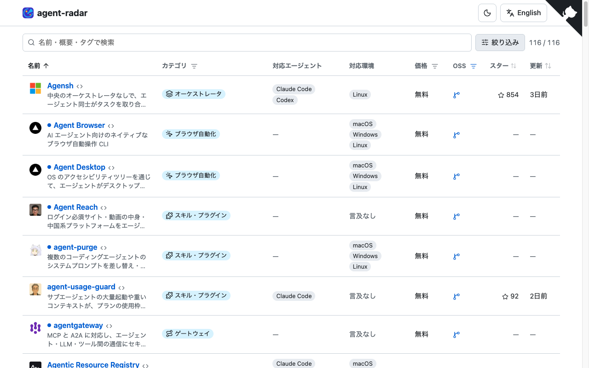

<p align="center"></p>

<h1 align="center">agent-radar</h1>

<p align="center"><b>AI エージェントのためのツールを探す。</b><br>コーディングエージェント、MCP サーバ、エージェントフレームワーク、サンドボックスなどを、検索と絞り込みができる 1 つの表で。</p>

<p align="center"><a href="https://asugawara.github.io/agent-radar/ja/"><b>agent-radar を開く →</b></a></p>

[English](README.md) | 日本語

agent-radar は、AI エージェントを作って動かすためのツールを一覧にした Web サイトです。1 行が 1 つのツールで、名前と概要、カテゴリ（コーディングエージェント、MCP サーバ、サンドボックスなど）、価格、GitHub のスター数、最終更新日を並べています。

Claude Code や Codex などのエージェントに使うツールを選びたい開発者向けです。誰でもツールを提案・追加できます（[ツールを追加する](#ツールを追加する)を参照してください）。

## どんな画面か



*日本語サイトの画面です。表の上に検索欄と絞り込みがあります。*

## できること

- **検索。** 名前・概要・タグで検索できます。
- **絞り込み。** カテゴリ・価格の見出しのボタンで絞り込めます。「絞り込み」を開くと、対応エージェント（Claude Code、Codex、Gemini CLI、Cursor）、インターフェース（CLI、IDE 拡張、デスクトップアプリなど）、機能、対応環境でも絞り込めます。対応エージェントと対応環境は、どの行でも同じ位置に並ぶ文字のタイルで表示されます。公式ページに記載があるものは塗りつぶし、無いものは枠だけの薄い表示になります。
- **並べ替え。** 名前・スター・更新の見出しをクリックすると並べ替えられます。
- **よくある質問。** 表の上に、よくある質問への短い答えを載せています（例: GitHub スター数が多い MCP サーバ）。答えはデータから組み立てています。上位のツール、該当する件数、日付を入れ、「すべて見る」を押すとその条件で絞り込んだ表が開きます。
- **ページ送り。** 一覧は 25 件ずつ表示します。表の下で 50 件・100 件にも切り替えられます。ページ番号と表示件数はアドレス（`page=2`、`per_page=50`）に残るので、リンクを開くと同じページが出ます。絞り込み・検索・並べ替え・表示件数を変えると 1 ページ目に戻ります。
- **2 言語。** 英語のサイトは `/`、日本語のサイトは `/ja/` にあります。
- **ライト／ダークとスマートフォン。** ヘッダーでテーマを切り替えられます。スマートフォンでは対応エージェント、対応環境、価格、カテゴリの列が隠れ、カテゴリは概要の下に表示されます。
- **既読と設定の保存。** 開いたツールは既読になり、未読のツールには青い点が付きます。「絞り込み」で未読／既読に絞れます。既読・言語・テーマはブラウザに保存されます。
- **リンク切れなし。** サイトが応答しなくなったツールは一覧から非表示にし、[削除されたツール](https://asugawara.github.io/agent-radar/ja/removed/)のページに載せます。サイトが復旧すると自動で戻ります。

## ツールを追加する

掲載するのは[掲載基準](docs/inclusion-policy.ja.md)を満たすツールだけです。

ツールを追加する方法は 3 つあります。手軽な順です。

1. **提案する。** [提案フォーム](https://github.com/Asugawara/agent-radar/issues/new?template=suggest-tool.yml)を開くか、サイトのフッターの「ツールを提案」を使います。準備は不要で、メンテナーが追加します。
2. **GitHub でファイルを作る。** サイトのフッターの「ツールを追加」を使うと、テンプレート付きの新規ファイル画面が開きます。ファイル名はツールの ID に変えてください。
3. **CLI で下書きを作る。** `cargo run -p radar-cli -- add <URL>`（GitHub リポジトリまたは製品ページの URL。`--id <id>` でファイル名を選び、`--dry-run` で表示だけもできます）を実行すると、名前・URL・リポジトリ・英語の概要・ライセンスを入れた `data/tools/<id>.toml` ができます。`summary.ja`、`platforms`、`tags` を埋めて `pricing` を確認し、`cargo run -p radar-cli -- validate` を実行してから、プルリクエストを開いてください。下書きのままでは、埋めるまで `validate` が失敗します。

ツールファイルの例（`data/tools/aider.toml` から、マージ後に入る `favicon` の行を除いたもの）:

```toml
name = "Aider"
url = "https://aider.chat"
repo = "Aider-AI/aider"
summary.en = "AI pair programming in your terminal that edits files in your git repo"
summary.ja = "git リポジトリ内のファイルを編集する、ターミナルで使う AI ペアプログラミングツール"
pricing = "free"
open_source = true
platforms = ["macos", "linux", "windows"]
tags = ["coding-agent", "cli", "model-agnostic"]
added = 2026-11-02
```

公式のページに対応 OS の記載が無いときは `platforms = ["unspecified"]`（言及なし）にしてください。推測で埋めないでください。

使えるタグは [`data/tags.toml`](data/tags.toml) にあります。マージ後に、スター数・最終更新日・ファビコンが自動で入ります。

## 開発

サイトは Rust で作っています（静的サイトの生成と、Rust/WASM で作る表）。

必要なもの: `wasm32-unknown-unknown` ターゲットを含む Rust stable（`rustup target add wasm32-unknown-unknown`）と [pre-commit](https://pre-commit.com/)。任意: `gitleaks` と `shellcheck`（フックが自前のコピーを取得します。手動で同じチェックをしたいときだけ入れてください）。

```sh
pre-commit install            # pre-commit と pre-push のフックを入れる
bash scripts/build-site.sh dist --base-url /
python3 -m http.server 8765 -d dist   # http://localhost:8765/ を開く
```

`build-site.sh` は、スター数を `GITHUB_TOKEN` が設定されているときだけ、ファビコンを `RADAR_SKIP_FAVICONS` が `1` でないときだけ取得します。wasm-bindgen-cli は、ない場合に `target/tools` の下へ入ります。

表の上によくある質問を載せるデータは `data/faq.toml` にあります。各 `[[faq]]` には `id`、`question.en/ja`、`answer.en/ja` と、任意で表のアドレスと同じキー（`tag`、`sort`、`pricing`、`platform`、例: `tag=mcp-server&sort=-stars`）を書いた `query` を入れます。任意の `top`（既定は 3）は `{top}` に並べるツールの数です。プレースホルダは、`{top}`（上位ツールとスター数）、`{n}`（条件に合うツールの数）、`{total}`（全ツール数）、`{date}`（ビルド日）です。`{top}` と `{n}` には `query` が必要で、英語と日本語の答えは同じプレースホルダを使う必要があります。条件に合うツールが 1 件もない項目は、ビルド時にスキップされます。

フックが動くタイミング:

| 段階 | フック | 実行されるとき |
| --- | --- | --- |
| commit | 空白、EOF、YAML/TOML、マージ競合、大きなファイル、改行コードのチェック | コミットのたび |
| commit | gitleaks、shellcheck | コミットのたび（shellcheck は `*.sh` のみ） |
| commit | `cargo fmt --check` | `*.rs` が変わったとき |
| commit | `radar validate`、`radar fmt --check` | `data/`、`i18n/`、`site.toml`、`.github/ISSUE_TEMPLATE/` が変わったとき |
| push | `cargo clippy --workspace --all-targets -- -D warnings`、`cargo test --workspace` | `*.rs` が変わったとき |

すべてを手動で実行するには `pre-commit run --all-files` を使います（遅いものも含めるには `--hook-stage pre-push` を追加します）。CI（`.github/workflows/ci.yml`）は同じチェックに加えて、サイトの全体ビルドを行います。

## デプロイ

自分のコピー（フォークなど）を GitHub Pages で公開するには:

1. Settings → Pages → Source で **GitHub Actions** を選びます。
2. `deploy.yml` は `main` への push のたびに公開します。`maintain.yml` は 6 時間ごとに実行され、リンクを確認し、データの変更があれば `bot/link-health` ブランチから PR を作って CI を起動し、リンクの状態を `bot-state` ブランチに保存してから、`deploy.yml` を呼び出します。データの変更はその PR をマージすると公開されます。
3. Search Console: URL プレフィックス形式のプロパティでは、`site.toml` の `google_site_verification` に「HTML タグ」方式の content の値を入れます（英数字・`-`・`_` のみ、10〜100 文字）。ビルドはこの値を `google-site-verification` の meta タグとして出力します。ビルドは、両言語のトップを載せた `sitemap.xml` も出力します。

## ライセンス

MIT（コードとデータ）。[LICENSE](LICENSE) を参照してください。

アイコン: Lucide（ISC）。[static/icons/LICENSE](static/icons/LICENSE) を参照してください。
