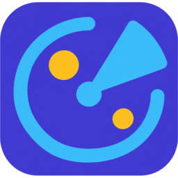
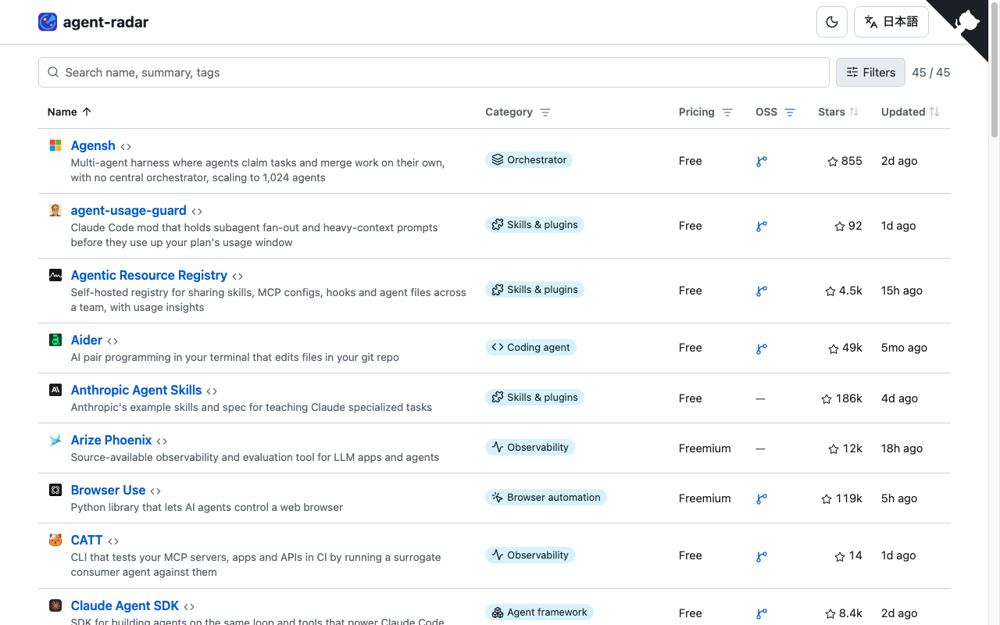

<p align="center"></p>

<h1 align="center">agent-radar</h1>

<p align="center"><b>Find tools for AI agents.</b><br>Coding agents, MCP servers, agent frameworks, sandboxes and more, in one table you can search and filter.</p>

<p align="center"><a href="https://asugawara.github.io/agent-radar/"><b>Open agent-radar →</b></a></p>

English | [日本語](README.ja.md)

agent-radar is a website that lists tools for building and running AI agents, one row per tool. Each row shows the tool's name and summary, its categories (such as Coding agent, MCP server or Sandbox), pricing, whether it is open source, its GitHub stars, and when it was last updated.

It is for developers choosing tools for Claude Code, Codex and other agents. Anyone can suggest or add a tool; see [Add a tool](#add-a-tool).

## What you see



*The English site: one row per tool, with search and filters above the table.*

## What you can do

- **Search.** Type a name, a summary or a tag to find a tool quickly.
- **Filter.** Use the filter buttons on the Category, Pricing and OSS headers, or open Filters to narrow by the agent a tool works with (Claude Code, Codex, Gemini CLI, Cursor), interface (CLI, IDE extension, desktop app and more), capability and platform.
- **Sort.** Click Name, Stars or Updated to sort the table.
- **Two languages.** The site is in English at `/` and in Japanese at `/ja/`.
- **Light, dark and phones.** Switch the theme from the header. On a phone, the pricing and OSS columns are hidden and categories appear under each summary.
- **No dead links.** A tool whose site stops responding is hidden and listed on the [Removed tools](https://asugawara.github.io/agent-radar/removed/) page, and it comes back when the site recovers.

## Add a tool

Three ways, from easiest to most hands-on:

1. **Suggest it.** [Open the suggestion form](https://github.com/Asugawara/agent-radar/issues/new?template=suggest-tool.yml), or use "Suggest a tool" in the site footer. No setup is needed; a maintainer adds the tool.
2. **Create the file on GitHub.** Use "Add a tool" in the site footer. It opens GitHub's new-file screen with a template; rename the file to the tool's id.
3. **Draft it with the CLI.** `cargo run -p radar-cli -- add <URL>` (a GitHub repository or a product page; add `--id <id>` to choose the file name, `--dry-run` to only print) writes `data/tools/<id>.toml` with name, URL, repo, English summary and license filled in. Fill in `summary.ja`, `platforms`, `tags` and check `pricing`, run `cargo run -p radar-cli -- validate`, then open a pull request. A fresh draft fails `validate` until those are filled in.

An example tool file (`data/tools/aider.toml`, without the `favicon` line that is added after a merge):

```toml
name = "Aider"
url = "https://aider.chat"
repo = "Aider-AI/aider"
summary.en = "AI pair programming in your terminal that edits files in your git repo"
summary.ja = "git リポジトリ内のファイルを編集する、ターミナルで使う AI ペアプログラミングツール"
pricing = "free"
open_source = true
platforms = ["macos", "linux", "windows"]
tags = ["coding-agent", "cli", "model-agnostic"]
added = 2026-11-02
```

Allowed tags are listed in [`data/tags.toml`](data/tags.toml). After a merge, stars, last update and the favicon are filled in automatically.

## Development

The site is built in Rust: a static generator and a Rust/WASM table.

Requirements: Rust stable with the `wasm32-unknown-unknown` target (`rustup target add wasm32-unknown-unknown`) and [pre-commit](https://pre-commit.com/). Optional: `gitleaks` and `shellcheck` (the hooks download their own copies; install them only to run the same checks by hand).

```sh
pre-commit install            # installs the pre-commit and pre-push hooks
bash scripts/build-site.sh dist --base-url /
python3 -m http.server 8765 -d dist   # open http://localhost:8765/
```

`build-site.sh` fetches stars and favicons only when `GITHUB_TOKEN` is set / `RADAR_SKIP_FAVICONS` is not `1`; wasm-bindgen-cli is installed under `target/tools` when missing.

When the hooks run:

| Stage | Hook | Runs when |
| --- | --- | --- |
| commit | whitespace, EOF, YAML/TOML, merge-conflict, large-file, line-ending checks | every commit |
| commit | gitleaks, shellcheck | every commit (shellcheck: `*.sh` only) |
| commit | `cargo fmt --check` | `*.rs` changed |
| commit | `radar validate`, `radar fmt --check` | `data/`, `i18n/`, `site.toml` or `.github/ISSUE_TEMPLATE/` changed |
| push | `cargo clippy --workspace --all-targets -- -D warnings`, `cargo test --workspace` | `*.rs` changed |

Run everything by hand with `pre-commit run --all-files` (add `--hook-stage pre-push` for the slow ones). CI (`.github/workflows/ci.yml`) runs the same checks plus a full site build.

## Deploy

To publish your own copy (for example a fork) on GitHub Pages:

1. Settings → Pages → Source: **GitHub Actions**.
2. `deploy.yml` publishes on every push to `main`. `maintain.yml` runs every 6 hours: it checks links, commits data changes to `main`, stores link health on the `bot-state` branch and then calls `deploy.yml`.

## License

MIT (code and data). See [LICENSE](LICENSE).

Icons: Lucide (ISC). See [static/icons/LICENSE](static/icons/LICENSE).
